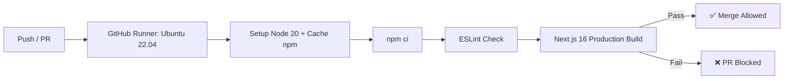

# Ganga Handmade Export (GHEF) 🌿🧶

[](https://nextjs.org/)
[](https://react.dev/)
[](https://www.typescriptlang.org/)
[](https://tailwindcss.com/)
[](https://neon.tech/)
[](https://orm.drizzle.team/)
[](.github/workflows/ci.yml)

> **World-class B2C & B2B digital export storefront and enterprise admin operations platform for authentic handcrafted Indian rugs, artisan carpets, and heritage home decor from Bhadohi & Mirzapur.**

---

## 📑 Table of Contents

- [Overview & Architecture](#-overview--architecture)
- [Key Features](#-key-features)
  - [Customer Storefront](#1-customer-storefront)
  - [Enterprise Admin Control Center](#2-enterprise-admin-control-center)
- [Tech Stack](#-tech-stack)
- [Getting Started](#-getting-started)
  - [Prerequisites](#prerequisites)
  - [Local Installation](#local-installation)
  - [Database Setup](#database-setup)
- [Admin Panel Roles & Operation Modes](#-admin-panel-roles--operation-modes)
- [Automated CI/CD & GitHub Actions](#-automated-cicd--github-actions)
- [Environment Configuration](#-environment-configuration)
- [Scripts & Commands](#-scripts--commands)
- [Project Directory Structure](#-project-directory-structure)
- [Deployment](#-deployment)
- [License](#-license)

---

## 🏛️ Overview & Architecture

Ganga Handmade Export bridges generational carpet weaving artisans with global luxury interior designers and homeowners. The platform is architected around two core engines:

1. **High-Performance Global Storefront**: Instant page loads via Next.js Partial Prerendering (PPR), dynamic currency formatting (₹ INR / Global), bespoke custom rug dimension calculators, and razor-sharp imagery via Cloudinary.
2. **Dual-Mode Enterprise Admin Panel**: Obsidian (`#0B132B`) and Electric Lime (`#bef264`) themed operations control with instant mode switching (`Normal Mode` for daily warehouse fulfillment vs `Pro Mode` for full store governance).

---

## 🌟 Key Features

### 1. Customer Storefront
- **Heritage Weaving Catalog**: Hand-knotted, hand-tufted, flat-weave dhurries, and natural jute collections.
- **Dynamic Dimension & Pricing Calculator**: Real-time price calculation per square foot/meter for bespoke artisan orders.
- **Omnichannel Checkout**: Seamless payment processing via Razorpay (UPI, Credit/Debit cards, NetBanking, EMI) and Cash-on-Delivery with pincode serviceability checks.
- **Customer Account Portal**: Real-time order tracking, digital invoice retrieval, shipping timeline updates, and wishlist management.
- **Bespoke Inquiries Engine**: Custom design submission with room photos and artisan weaving brief forms.

### 2. Enterprise Admin Control Center
- **Always-Accessible Mode Switcher (`Normal` vs `Pro ⚡`)**: Switchable anytime from the top-right toolbar.
  - **🌿 Normal Mode**: Streamlined view showing only necessary daily operational modules (Dashboard, Analytics, Products, Categories, Inventory, Orders, Customers, Enquiries, Reviews).
  - **⚡ Pro Mode**: Unlocks the entire enterprise suite (Abandoned cart recovery, Payment ledgers, Razorpay webhooks, Audit trails, Email quotas, Banners, and Team permissions).
- **Sales & Performance Trajectory Graph**:
  - Multi-metric selectors: `Revenue (₹)`, `Order Count`, `Average Order Value (AOV)`, `Active Customers`, and `Bespoke Inquiries`.
  - Chart styles: Switch between **Area Trend Curve** and **Bar Graph Columns**.
  - Live KPI highlights banner: Period Total, Peak Spike Interval, and Run-Rate Growth Trend.
- **Warehouse Stock Signals**: Real-time low-stock alerts with 1-click inline stock replenishment.
- **Order Pipeline & Fulfillment Station**: Filter by date range (`24h`, `7d`, `30d`, `90d`, `365d`, `Custom`), status pills (`Placed`, `Processing`, `Shipped`, `Delivered`, `Cancelled`), and export packing slips.
- **Security & Role-Based Access Control (RBAC)**: Fine-grained permissions across `Owner`, `Admin`, and `Staff` with secure password hashing and session tokens.

---

## 🛠️ Tech Stack

| Layer | Technology | Purpose |
|---|---|---|
| **Framework** | Next.js 16.4.3 (App Router + Turbopack) | Server components, Server Actions, PPR caching |
| **UI Library** | React 19.3.0 + Tailwind CSS v4 | Cutting-edge reactive primitives, zero runtime CSS |
| **Design System** | Radix UI + Lucide Icons + Sonner | Accessible dropdowns, select menus, dialogs, toasts |
| **Database** | Neon Serverless PostgreSQL | High-concurrency relational data with connection pooling |
| **ORM** | Drizzle ORM 0.45 + Drizzle Kit | Fully type-safe schemas, automated migrations, fast seeds |
| **Authentication** | Auth.js (NextAuth v5) + Admin Session | Customer OAuth & Admin HMAC-signed JWT sessions |
| **Payments** | Razorpay Node SDK | Domestic & international cards, UPI, webhook telemetry |
| **Media Assets** | Cloudinary CDN | High-resolution rug image hosting & auto-optimization |
| **Email Service** | Resend API | Transactional order emails, dispatch alerts, quote notices |
| **CI / CD** | GitHub Actions | Automated Linting (`ESLint`) and Typecheck Build verification |

---

## 🚀 Getting Started

### Prerequisites
- **Node.js**: `20.19.0` or newer
- **npm**: `10.0.0` or newer
- **PostgreSQL**: Neon Postgres instance or local PostgreSQL 16+

### Local Installation

1. **Clone the repository**:
   ```bash
   git clone https://github.com/your-org/ganga-handmade-export.git
   cd ganga-handmade-export
   ```

2. **Install project dependencies**:
   ```bash
   npm install
   ```

3. **Configure Environment Variables**:
   Copy `.env.example` to `.env.local`:
   ```bash
   cp .env.example .env.local
   ```
   Open `.env.local` and configure your database and authentication keys (see [Environment Configuration](#-environment-configuration)).

### Database Setup

1. **Generate migrations from schema**:
   ```bash
   npm run db:generate
   ```

2. **Apply migrations to Neon / Postgres**:
   ```bash
   npm run db:migrate
   ```

3. **Seed initial handcrafted rugs catalogue & admin account**:
   ```bash
   npm run db:seed
   ```

4. **Launch development server**:
   ```bash
   npm run dev
   ```
   Open [http://localhost:3000](http://localhost:3000) for the storefront, or [http://localhost:3000/admin](http://localhost:3000/admin) for the admin portal.

---

## 🔐 Admin Panel Roles & Operation Modes

### Operational Modes

The admin panel provides a toggle located in the **top-right navigation bar**:

```
[ 🌿 Normal Mode ]   [ ⚡ Pro Mode ]
```

- **🌿 Normal Mode (Operations Focus)**: Removes sidebar clutter and presents only daily warehouse tasks: Orders, Stock adjustments, Products, Categories, Enquiries, and Traffic Analytics.
- **⚡ Pro Mode (Executive Suite)**: Surfaces all modules including Abandoned Cart Recovery, Gateway Ledger, Razorpay Webhooks, Audit Logs, Promotional Banners, Coupons, and Admin Team Access.

### Role Hierarchy

| Role | Access Scope |
|---|---|
| **Owner** | Full unrestricted access: Database settings, team invitations, email quotas, Razorpay credentials, audit trails. |
| **Admin** | Financial telemetry, customer directory, coupon creation, banners, newsletter subscribers, abandoned carts. |
| **Staff** | Daily operations: Catalog updates, image uploads, stock counts, order fulfillment, bespoke inquiries, reviews. |

---

## 🤖 Automated CI/CD & GitHub Actions

Every commit pushed and every Pull Request opened triggers the automated GitHub Actions pipeline ([`.github/workflows/ci.yml`](.github/workflows/ci.yml)):



### Protection Enforcement:
To enforce this rule on your repository:
1. Navigate to **GitHub Repo** → **Settings** → **Branches**.
2. Add a rule for `main`.
3. Check **Require a pull request before merging** and **Require status checks to pass before merging**.
4. Select `Lint & Build Verification`.

---

## ⚙️ Environment Configuration

| Variable | Required | Description |
|---|:---:|---|
| `DATABASE_URL` | **Yes** | Pooled PostgreSQL connection string (Neon) |
| `DATABASE_URL_UNPOOLED` | **Yes** | Direct connection string for Drizzle migrations |
| `AUTH_SECRET` | **Yes** | NextAuth encryption key (`openssl rand -base64 32`) |
| `ADMIN_EMAIL` | **Yes** | Default Owner email address for admin login |
| `ADMIN_PASSWORD` | **Yes** | Default Owner password (minimum 12 characters) |
| `NEXT_PUBLIC_APP_URL` | **Yes** | Public canonical URL (e.g., `https://gangahandmade.com`) |
| `NEXT_PUBLIC_CLOUDINARY_CLOUD_NAME` | Optional | Cloudinary cloud identifier for rug gallery imagery |
| `CLOUDINARY_API_KEY` | Optional | Cloudinary API key for secure backend uploads |
| `CLOUDINARY_API_SECRET` | Optional | Cloudinary API secret |
| `NEXT_PUBLIC_RAZORPAY_KEY_ID` | Optional | Razorpay public key ID for storefront checkout |
| `RAZORPAY_KEY_SECRET` | Optional | Razorpay private secret for signature verification |
| `RAZORPAY_WEBHOOK_SECRET` | Optional | Razorpay webhook secret for signature verification |
| `RESEND_API_KEY` | Optional | Resend API key for transactional email dispatches |
| `NOTIFY_EMAIL` | Optional | Store manager notification inbox for new orders |

---

## 📜 Scripts & Commands

```bash
# Development server (Turbopack enabled)
npm run dev

# Full production build with TypeScript & route compilation
npm run build

# Start production web server
npm run start

# Run ESLint validation
npm run lint

# Execute unit and integration tests
npm test

# Generate new Drizzle migration files
npm run db:generate

# Execute pending database migrations
npm run db:migrate

# Seed sample catalogue, categories, and owner account
npm run db:seed
```

---

## 📂 Project Directory Structure

```text
├── .github/
│   └── workflows/
│       └── ci.yml               # Automated CI (ESLint + Next.js build verification)
├── drizzle/                     # Auto-generated SQL migration files
├── src/
│   ├── app/
│   │   ├── (store)/             # Customer storefront routes (home, catalog, cart, checkout)
│   │   ├── admin/
│   │   │   ├── (panel)/         # Role-guarded admin panel modules (orders, inventory, etc.)
│   │   │   └── login/           # Admin credential authentication portal
│   │   └── api/                 # Webhooks, NextAuth routes, checkout endpoints
│   ├── components/
│   │   ├── admin/               # Admin panel navigation, dashboard, forms, and charts
│   │   ├── store/               # Storefront navigation, product cards, rug customizer
│   │   └── ui/                  # Radix UI primitives (select, tooltip, dialogs)
│   ├── lib/                     # Currency formatting, utilities, sanitizers
│   └── server/
│       ├── actions/             # Next.js Server Actions for mutations
│       ├── auth/                # Session tokens, HMAC cookies, and RBAC guards
│       ├── db/                  # Drizzle ORM schemas, database client, seed script
│       └── services/            # Core business logic (analytics, fulfillment, ledger)
├── eslint.config.mjs            # Flat ESLint configuration
├── next.config.ts               # Next.js 16 configuration with PPR and image domains
├── package.json                 # Project dependencies and script definitions
└── tsconfig.json                # TypeScript strict configuration
```

---

## 🚢 Deployment

### Deploying to Vercel
1. Push your repository to GitHub.
2. Import the project into your **Vercel Dashboard**.
3. In **Project Settings** → **Environment Variables**, add all keys from your `.env.local`.
4. Deploy! Next.js 16 Turbopack build will compile all routes with Partial Prerendering automatically enabled.

---

## 📄 License

Proprietary © **Ganga Handmade Export**. All rights reserved.
Developed for artisanal weaving communities and global luxury interior exports.
